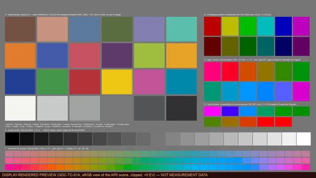

# GDC Test Charts 4K

[English](README.md) · [Română](README.ro.md) · [Página web](https://gordas.dev/gdc-test-charts-4k/es/)

**Cartas de prueba gratuitas y abiertas para flujos de color: 575 imágenes EXR float32 de 3840×2160 en 23 configuraciones colorimétricas y 12 familias de pruebas.**

## Qué es

Una biblioteca de cartas de prueba definidas matemáticamente para comprobar IDT, ODT, DRT, LUT, plugins OFX y transformaciones DCTL en DaVinci Resolve (o en cualquier flujo scene-referred). Las mismas 25 cartas se generan por separado en 23 configuraciones de gamut y curva, para probar una herramienta en el espacio en el que realmente trabaja.

## Descarga

No hace falta cuenta, pago ni aplicación. **La biblioteca completa son 4 archivos ZIP** (tres partes con configuraciones distintas más el archivo de documentación y metadatos). No se ofrece un único ZIP «todo»: los datos rondan los 3,05 GB y un asset de GitHub está limitado a 2 GiB. Cada ZIP tiene su propia carpeta principal, así que los archivos no chocan.

**Biblioteca completa (descarga las tres partes y docs-metadata)**

| Archivo | Tamaño | SHA-256 |
|---|---:|---|
| [`gdc-test-charts-4k-1.0.0-complete-part1of3.zip`](https://github.com/gordasgdc/gdc-test-charts-4k/releases/download/v1.0.0/gdc-test-charts-4k-1.0.0-complete-part1of3.zip) | 1.06 GB | `5e738c6bdb6fac3d2d7df0b1945c2a80f68e495920d0675d9c3afa6872bfa1d1` |
| [`gdc-test-charts-4k-1.0.0-complete-part2of3.zip`](https://github.com/gordasgdc/gdc-test-charts-4k/releases/download/v1.0.0/gdc-test-charts-4k-1.0.0-complete-part2of3.zip) | 1.06 GB | `aa25aac29951695fa1195508cd69f6946dfbe3dae3b5dd38a7bdc1a0b9084fe1` |
| [`gdc-test-charts-4k-1.0.0-complete-part3of3.zip`](https://github.com/gordasgdc/gdc-test-charts-4k/releases/download/v1.0.0/gdc-test-charts-4k-1.0.0-complete-part3of3.zip) | 931 MB | `f8746434b2cca31315bcea331c29a40be9255dea176503a412ff3ab6a4c70075` |
| [`gdc-test-charts-4k-1.0.0-docs-metadata.zip`](https://github.com/gordasgdc/gdc-test-charts-4k/releases/download/v1.0.0/gdc-test-charts-4k-1.0.0-docs-metadata.zip) | 17 MB | `2d9990e847e515c6e7581a2364b7259b714c7984576554801894ce7d774eb032` |

Configuraciones individuales (opcional, unos 130 MB cada una; repiten contenido de las partes): [`aces2065_ap0_lin`](https://github.com/gordasgdc/gdc-test-charts-4k/releases/download/v1.0.0/gdc-test-charts-4k-1.0.0-config-aces2065_ap0_lin.zip), [`acescct_ap1`](https://github.com/gordasgdc/gdc-test-charts-4k/releases/download/v1.0.0/gdc-test-charts-4k-1.0.0-config-acescct_ap1.zip), [`acescg_ap1_lin`](https://github.com/gordasgdc/gdc-test-charts-4k/releases/download/v1.0.0/gdc-test-charts-4k-1.0.0-config-acescg_ap1_lin.zip), [`apple_log_rec2020`](https://github.com/gordasgdc/gdc-test-charts-4k/releases/download/v1.0.0/gdc-test-charts-4k-1.0.0-config-apple_log_rec2020.zip), [`arri_awg3_logc3_ei800`](https://github.com/gordasgdc/gdc-test-charts-4k/releases/download/v1.0.0/gdc-test-charts-4k-1.0.0-config-arri_awg3_logc3_ei800.zip), [`arri_awg4_logc4`](https://github.com/gordasgdc/gdc-test-charts-4k/releases/download/v1.0.0/gdc-test-charts-4k-1.0.0-config-arri_awg4_logc4.zip), [`bmd_widegamut_gen4_filmgen4`](https://github.com/gordasgdc/gdc-test-charts-4k/releases/download/v1.0.0/gdc-test-charts-4k-1.0.0-config-bmd_widegamut_gen4_filmgen4.zip), [`bmd_widegamut_gen5_filmgen5`](https://github.com/gordasgdc/gdc-test-charts-4k/releases/download/v1.0.0/gdc-test-charts-4k-1.0.0-config-bmd_widegamut_gen5_filmgen5.zip), [`canon_cinemagamut_clog1`](https://github.com/gordasgdc/gdc-test-charts-4k/releases/download/v1.0.0/gdc-test-charts-4k-1.0.0-config-canon_cinemagamut_clog1.zip), [`canon_cinemagamut_clog2`](https://github.com/gordasgdc/gdc-test-charts-4k/releases/download/v1.0.0/gdc-test-charts-4k-1.0.0-config-canon_cinemagamut_clog2.zip), [`canon_cinemagamut_clog3`](https://github.com/gordasgdc/gdc-test-charts-4k/releases/download/v1.0.0/gdc-test-charts-4k-1.0.0-config-canon_cinemagamut_clog3.zip), [`dji_dgamut_dlog`](https://github.com/gordasgdc/gdc-test-charts-4k/releases/download/v1.0.0/gdc-test-charts-4k-1.0.0-config-dji_dgamut_dlog.zip), [`dwg_davinci_intermediate`](https://github.com/gordasgdc/gdc-test-charts-4k/releases/download/v1.0.0/gdc-test-charts-4k-1.0.0-config-dwg_davinci_intermediate.zip), [`filmlight_egamut_tlog`](https://github.com/gordasgdc/gdc-test-charts-4k/releases/download/v1.0.0/gdc-test-charts-4k-1.0.0-config-filmlight_egamut_tlog.zip), [`fujifilm_fgamut_flog`](https://github.com/gordasgdc/gdc-test-charts-4k/releases/download/v1.0.0/gdc-test-charts-4k-1.0.0-config-fujifilm_fgamut_flog.zip), [`fujifilm_fgamut_flog2`](https://github.com/gordasgdc/gdc-test-charts-4k/releases/download/v1.0.0/gdc-test-charts-4k-1.0.0-config-fujifilm_fgamut_flog2.zip), [`fujifilm_fgamutc_flog2c`](https://github.com/gordasgdc/gdc-test-charts-4k/releases/download/v1.0.0/gdc-test-charts-4k-1.0.0-config-fujifilm_fgamutc_flog2c.zip), [`gopro_rec2020_gplog2`](https://github.com/gordasgdc/gdc-test-charts-4k/releases/download/v1.0.0/gdc-test-charts-4k-1.0.0-config-gopro_rec2020_gplog2.zip), [`nikon_ngamut_nlog`](https://github.com/gordasgdc/gdc-test-charts-4k/releases/download/v1.0.0/gdc-test-charts-4k-1.0.0-config-nikon_ngamut_nlog.zip), [`panasonic_vgamut_vlog`](https://github.com/gordasgdc/gdc-test-charts-4k/releases/download/v1.0.0/gdc-test-charts-4k-1.0.0-config-panasonic_vgamut_vlog.zip), [`red_rwg_log3g10`](https://github.com/gordasgdc/gdc-test-charts-4k/releases/download/v1.0.0/gdc-test-charts-4k-1.0.0-config-red_rwg_log3g10.zip), [`sony_sgamut3_slog3`](https://github.com/gordasgdc/gdc-test-charts-4k/releases/download/v1.0.0/gdc-test-charts-4k-1.0.0-config-sony_sgamut3_slog3.zip), [`sony_sgamut3cine_slog3`](https://github.com/gordasgdc/gdc-test-charts-4k/releases/download/v1.0.0/gdc-test-charts-4k-1.0.0-config-sony_sgamut3cine_slog3.zip)

[SHA256SUMS.txt](https://github.com/gordasgdc/gdc-test-charts-4k/releases/download/v1.0.0/SHA256SUMS.txt) · [release v1.0.0](https://github.com/gordasgdc/gdc-test-charts-4k/releases/tag/v1.0.0)

## Qué contienen los datos

Cada carpeta de configuración contiene las 25 cartas (`GDC-TC-<ID>_<slug>__<configuración>__3840x2160.exr`) y una subcarpeta `MASTER/` con su archivo de referencia `GDC_STUDIO_MASTER_4K`. El archivo `docs-metadata` incluye los manifiestos por carta (ROI, valores de referencia, pruebas previstas, limitaciones, procedencia, SHA-256), el informe de validación, `CATALOG.csv` y vistas previas sRGB.

## Familias

| ID | Familia | Qué prueba |
|---|---|---|
| 01 | Colorimetría | Compruebas la exactitud de una transformación con 24 parches de referencia, 21 escalones neutros, primarios, trayectorias de matiz y puntos de estrés de gamut. La variante extendida añade cortes LCh, límites de gamut y una escala ΔE. |
| 02 | Piel | 02A contiene valores construidos de tonos de piel: rejilla ITA, iluminantes, exposición y trayectorias. 02B es un busto sintético, una ILUSTRACIÓN para probar máscaras espaciales, sin valores de referencia. |
| 03 | Exposición | Escalas de 1 stop, 1/3 de stop y Zone System, color frente a exposición, headroom y rampas continuas en stops logarítmicos o lineales. Muestran dónde se comprimen o se desplazan los tonos. |
| 04 | Saturación y matiz | Barridos de saturación a luminancia constante o variable, ruedas de matiz y croma, rampas de matiz, linealidad del matiz e interacción matiz × luminancia. Útil para detectar desviaciones de matiz. |
| 05 | Balance de blancos | Iluminantes × reflectancias, desplazamiento de tinte (Duv), cinco métodos de adaptación cromática (CAT) y rejillas de error casi neutras, incluida la piel frente al neutro bajo distintos iluminantes. |
| 06 | Halation y bloom | Fuentes puntuales de distintos tamaños e intensidades, emisores de color, bordes, transiciones de contraste, líneas de neón y veiling glare, para ver cómo se dispersa la luz en efectos de película o de lente. |
| 07 | Enfoque y MTF | Bordes inclinados para el método slanted-edge, estrellas de Siemens, zone plates, chirps, pares de líneas y bordes de bajo contraste, para estimar resolución y microcontraste. |
| 08 | Grano y ruido | 08A es la referencia LIMPIA, sin ruido. 08B tiene variantes CON ruido gaussiano controlado y semilla fija, etiquetadas. Parte de la limpia y compara con el efecto de una herramienta de grano o de reducción de ruido. |
| 09 | Sombras | Escalones casi negros, valores bajo el negro y negativos, escala de crush, rampas de poca luz, el cruce por cero y croma en sombras. Muestran dónde se pierden o se tiñen las sombras. |
| 10 | Altas luces y roll-off | Escalones y rampas en las altas luces, altas luces saturadas, sobrecarga de un canal, emisores y sondas de compresión de gamut. Prueban cómo se comporta un look o un DRT en el extremo superior. |
| 11 | Degradados y banding | Rampas neutras muy estrechas con cuantización simulada de 10, 8 y 6 bits, degradados de matiz, croma de baja amplitud, degradados casi negros o blancos y degradados 2D. Revelan el banding de una cadena de procesamiento. |
| 12 | Lente y óptica (sintético) | Rejilla recta para distorsión, campos planos, matriz de puntos y bordes tangenciales/sagitales en 3×3 posiciones de campo. Son patrones SINTÉTICOS para herramientas de corrección, no mediciones de objetivo. |

## Configuraciones

| Carpeta = identificador de configuración | Gamut | Curva |
|---|---|---|
| `aces2065_ap0_lin` | ACES2065-1 (AP0) | scene-linear |
| `acescct_ap1` | ACES AP1 | ACEScct |
| `acescg_ap1_lin` | ACES AP1 (ACEScg) | scene-linear |
| `apple_log_rec2020` | Rec.2020 (gamutul Apple Log) | Apple Log |
| `arri_awg3_logc3_ei800` | ARRI Wide Gamut 3 | ARRI LogC3 (EI 800) |
| `arri_awg4_logc4` | ARRI Wide Gamut 4 | ARRI LogC4 |
| `bmd_widegamut_gen4_filmgen4` | Blackmagic Wide Gamut Gen 4/5 | Blackmagic Film Gen 4 (Broadcast) |
| `bmd_widegamut_gen5_filmgen5` | Blackmagic Wide Gamut Gen 5 | Blackmagic Film Gen 5 |
| `canon_cinemagamut_clog1` | Canon Cinema Gamut | Canon Log |
| `canon_cinemagamut_clog2` | Canon Cinema Gamut | Canon Log 2 |
| `canon_cinemagamut_clog3` | Canon Cinema Gamut | Canon Log 3 |
| `dji_dgamut_dlog` | DJI D-Gamut | DJI D-Log |
| `dwg_davinci_intermediate` | DaVinci Wide Gamut | DaVinci Intermediate |
| `filmlight_egamut_tlog` | FilmLight E-Gamut | FilmLight T-Log |
| `fujifilm_fgamut_flog` | Fujifilm F-Gamut (primare Rec.2020) | Fujifilm F-Log |
| `fujifilm_fgamut_flog2` | Fujifilm F-Gamut (primare Rec.2020) | Fujifilm F-Log2 |
| `fujifilm_fgamutc_flog2c` | Fujifilm F-Gamut C | Fujifilm F-Log2 C |
| `gopro_rec2020_gplog2` | Rec.2020 (gamutul GP-Log2 conform GoPro) | GoPro GP-Log2 |
| `nikon_ngamut_nlog` | Rec.2020 (gamutul N-Log conform Nikon) | Nikon N-Log |
| `panasonic_vgamut_vlog` | Panasonic V-Gamut | Panasonic V-Log |
| `red_rwg_log3g10` | REDWideGamutRGB | RED Log3G10 |
| `sony_sgamut3_slog3` | Sony S-Gamut3 | Sony S-Log3 |
| `sony_sgamut3cine_slog3` | Sony S-Gamut3.Cine | Sony S-Log3 |

## Uso (DaVinci Resolve)

1. Elige la configuración que corresponde al espacio en el que trabaja la herramienta que pruebas (por ejemplo `dwg_davinci_intermediate` para un flujo DaVinci Wide Gamut / Intermediate).
2. Extrae el ZIP e importa al Media Pool los EXR de la carpeta de esa configuración.
3. Declara exactamente el espacio de entrada: el gamut y la curva del nombre de la carpeta, mediante la gestión de color del proyecto (espacio de entrada del clip) o un nodo Color Space Transform.
4. Evita la doble transformación: si el proyecto ya convierte la entrada, no añadas una segunda conversión para el mismo espacio. Los EXR no llevan una curva de transferencia que la aplicación pueda deducir.
5. Mide sobre píxeles reales con los ROI (rectángulos en píxeles) y los valores de referencia del manifiesto de cada carta (`docs-metadata`).
6. Lee los límites siguientes antes de sacar conclusiones.

## Contrato de datos

OpenEXR, RGB, float32 (IEEE binary32), compresión ZIP sin pérdida, 3840×2160, scene-referred, full-range, sin tone mapping ni renderizado para pantalla, sin clipping. Los valores negativos y superiores a 1 son intencionados (estrés de gamut, headroom, sub-negro). Cada carta se compone una vez en ACES2065-1 (AP0, lineal) y se convierte AP0 → XYZ D65 (Bradford) → gamut de destino → curva de destino. Los mismos valores de código en dos configuraciones **no** son el mismo color. Los EXR son idénticos byte a byte a los originales: sin conversión a half-float, sin clipping, sin recompresión.

### Las vistas previas no son datos

`previews/` contiene renders WebP para pantallas sRGB; pueden estar recortados y sirven solo para navegar. Mide sobre los EXR, nunca sobre vistas previas o capturas de pantalla.



## Verifica la descarga

Compara el SHA-256 de cada ZIP con la tabla anterior o con `SHA256SUMS.txt` del release. Dentro de cada ZIP, `SHA256SUMS.txt` lista cada EXR.

```bash
shasum -a 256 gdc-test-charts-4k-1.0.0-complete-part1of3.zip      # macOS / Linux
```

```powershell
Get-FileHash -Algorithm SHA256 .\gdc-test-charts-4k-1.0.0-complete-part1of3.zip   # Windows
```

## Límites

- Las cartas son sintéticas: no son capturas de cámara ni cartas físicas medidas. Los valores del ColorChecker (CC24) son medias CIELAB nominales publicadas, adaptadas a D65 (los lotes físicos difieren en torno a 1–2 ΔE).
- No son una calibración ni una certificación de monitores, objetivos o cámaras. 02B (busto sintético) y la familia 12 (lente y óptica) son ilustraciones/simulaciones.
- Versión del generador: 1.0.0-proto. Su informe interno registra 32 364 comprobaciones automáticas con 0 fallos; en esta publicación esa validación **no** se volvió a ejecutar. Verificamos presencia de archivos, tamaños y SHA-256 contra el catálogo, y la existencia de los 23 archivos MASTER. La aprobación visual de la maquetación por una persona sigue pendiente.
- 08B contiene a propósito ruido gaussiano controlado (semilla fija). Las filas cuantizadas de 11A se cuantizan en el dominio del código almacenado, por configuración.
- El generador no forma parte de este release.

## Licencia y atribución

Cartas, manifiestos y documentación: [Creative Commons Attribution 4.0 International (CC BY 4.0)](https://creativecommons.org/licenses/by/4.0/) — uso, modificación y redistribución, también comercial, con atribución. Los scripts auxiliares de `scripts/` se publican aparte bajo la licencia MIT (ver `LICENSE-SCRIPTS`); CC BY no se usa para software. Los nombres de cámaras, formatos y espacios de color pertenecen a sus propietarios y aparecen solo como identificadores técnicos; las fórmulas proceden de especificaciones públicas.

Atribución recomendada: `GDC Test Charts 4K © 2026 Dumitru Cristinel Gordas — https://gordas.dev/gdc-test-charts-4k/ — CC BY 4.0`

## Contenido del repositorio

`scripts/` inventario, empaquetado, verificación, generación de README/página · `previews/` vistas previas WebP optimizadas · `docs/` tabla de descargas y notas de publicación · `LICENSE` texto legal CC BY 4.0 · `LICENSE-SCRIPTS` MIT. Los EXR solo existen en GitHub Releases, nunca en el historial de Git.

### Reproducir las comprobaciones

`python3 scripts/inventory.py --hash --out report.json` (conciliación de la fuente) · `python3 scripts/verify_archives.py --dir <carpeta con los ZIP y packages.json> --catalog CATALOG.csv --extract <carpeta nueva y vacía>` (contenido, SHA-256, extracción).
