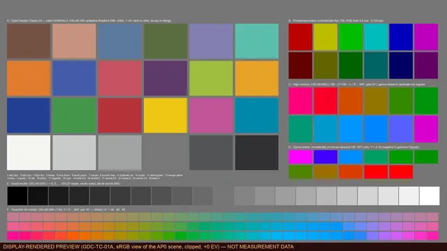

# GDC Test Charts 4K

[Română](README.ro.md) · [Español](README.es.md) · [Web page](https://gordas.dev/gdc-test-charts-4k/en/)

**Free, open test charts for colour pipelines: 575 EXR float32 images at 3840×2160 in 23 colour configurations and 12 test families.**

## What it is

A library of mathematically defined test charts to check IDTs, ODTs, DRTs, LUTs, OFX plugins and DCTL transforms in DaVinci Resolve (or any scene-referred pipeline). The same 25 charts are rendered separately in 23 gamut-and-curve configurations, so you can test a tool in the space it actually works in.

## Download

No account, payment or app is needed. **The complete library is 4 ZIP files** (three parts that hold different configurations, plus the documentation/metadata archive). A single “everything” ZIP is not offered: the data is about 3.05 GB and a GitHub asset is limited to 2 GiB. Every ZIP has its own top-level folder, so archives never collide.

**Complete library (download all three parts, plus docs-metadata)**

| File | Size | SHA-256 |
|---|---:|---|
| [`gdc-test-charts-4k-1.0.0-complete-part1of3.zip`](https://github.com/gordasgdc/gdc-test-charts-4k/releases/download/v1.0.0/gdc-test-charts-4k-1.0.0-complete-part1of3.zip) | 1.06 GB | `5e738c6bdb6fac3d2d7df0b1945c2a80f68e495920d0675d9c3afa6872bfa1d1` |
| [`gdc-test-charts-4k-1.0.0-complete-part2of3.zip`](https://github.com/gordasgdc/gdc-test-charts-4k/releases/download/v1.0.0/gdc-test-charts-4k-1.0.0-complete-part2of3.zip) | 1.06 GB | `aa25aac29951695fa1195508cd69f6946dfbe3dae3b5dd38a7bdc1a0b9084fe1` |
| [`gdc-test-charts-4k-1.0.0-complete-part3of3.zip`](https://github.com/gordasgdc/gdc-test-charts-4k/releases/download/v1.0.0/gdc-test-charts-4k-1.0.0-complete-part3of3.zip) | 931 MB | `f8746434b2cca31315bcea331c29a40be9255dea176503a412ff3ab6a4c70075` |
| [`gdc-test-charts-4k-1.0.0-docs-metadata.zip`](https://github.com/gordasgdc/gdc-test-charts-4k/releases/download/v1.0.0/gdc-test-charts-4k-1.0.0-docs-metadata.zip) | 17 MB | `2d9990e847e515c6e7581a2364b7259b714c7984576554801894ce7d774eb032` |

Single configurations (optional, about 130 MB each; they repeat content of the parts): [`aces2065_ap0_lin`](https://github.com/gordasgdc/gdc-test-charts-4k/releases/download/v1.0.0/gdc-test-charts-4k-1.0.0-config-aces2065_ap0_lin.zip), [`acescct_ap1`](https://github.com/gordasgdc/gdc-test-charts-4k/releases/download/v1.0.0/gdc-test-charts-4k-1.0.0-config-acescct_ap1.zip), [`acescg_ap1_lin`](https://github.com/gordasgdc/gdc-test-charts-4k/releases/download/v1.0.0/gdc-test-charts-4k-1.0.0-config-acescg_ap1_lin.zip), [`apple_log_rec2020`](https://github.com/gordasgdc/gdc-test-charts-4k/releases/download/v1.0.0/gdc-test-charts-4k-1.0.0-config-apple_log_rec2020.zip), [`arri_awg3_logc3_ei800`](https://github.com/gordasgdc/gdc-test-charts-4k/releases/download/v1.0.0/gdc-test-charts-4k-1.0.0-config-arri_awg3_logc3_ei800.zip), [`arri_awg4_logc4`](https://github.com/gordasgdc/gdc-test-charts-4k/releases/download/v1.0.0/gdc-test-charts-4k-1.0.0-config-arri_awg4_logc4.zip), [`bmd_widegamut_gen4_filmgen4`](https://github.com/gordasgdc/gdc-test-charts-4k/releases/download/v1.0.0/gdc-test-charts-4k-1.0.0-config-bmd_widegamut_gen4_filmgen4.zip), [`bmd_widegamut_gen5_filmgen5`](https://github.com/gordasgdc/gdc-test-charts-4k/releases/download/v1.0.0/gdc-test-charts-4k-1.0.0-config-bmd_widegamut_gen5_filmgen5.zip), [`canon_cinemagamut_clog1`](https://github.com/gordasgdc/gdc-test-charts-4k/releases/download/v1.0.0/gdc-test-charts-4k-1.0.0-config-canon_cinemagamut_clog1.zip), [`canon_cinemagamut_clog2`](https://github.com/gordasgdc/gdc-test-charts-4k/releases/download/v1.0.0/gdc-test-charts-4k-1.0.0-config-canon_cinemagamut_clog2.zip), [`canon_cinemagamut_clog3`](https://github.com/gordasgdc/gdc-test-charts-4k/releases/download/v1.0.0/gdc-test-charts-4k-1.0.0-config-canon_cinemagamut_clog3.zip), [`dji_dgamut_dlog`](https://github.com/gordasgdc/gdc-test-charts-4k/releases/download/v1.0.0/gdc-test-charts-4k-1.0.0-config-dji_dgamut_dlog.zip), [`dwg_davinci_intermediate`](https://github.com/gordasgdc/gdc-test-charts-4k/releases/download/v1.0.0/gdc-test-charts-4k-1.0.0-config-dwg_davinci_intermediate.zip), [`filmlight_egamut_tlog`](https://github.com/gordasgdc/gdc-test-charts-4k/releases/download/v1.0.0/gdc-test-charts-4k-1.0.0-config-filmlight_egamut_tlog.zip), [`fujifilm_fgamut_flog`](https://github.com/gordasgdc/gdc-test-charts-4k/releases/download/v1.0.0/gdc-test-charts-4k-1.0.0-config-fujifilm_fgamut_flog.zip), [`fujifilm_fgamut_flog2`](https://github.com/gordasgdc/gdc-test-charts-4k/releases/download/v1.0.0/gdc-test-charts-4k-1.0.0-config-fujifilm_fgamut_flog2.zip), [`fujifilm_fgamutc_flog2c`](https://github.com/gordasgdc/gdc-test-charts-4k/releases/download/v1.0.0/gdc-test-charts-4k-1.0.0-config-fujifilm_fgamutc_flog2c.zip), [`gopro_rec2020_gplog2`](https://github.com/gordasgdc/gdc-test-charts-4k/releases/download/v1.0.0/gdc-test-charts-4k-1.0.0-config-gopro_rec2020_gplog2.zip), [`nikon_ngamut_nlog`](https://github.com/gordasgdc/gdc-test-charts-4k/releases/download/v1.0.0/gdc-test-charts-4k-1.0.0-config-nikon_ngamut_nlog.zip), [`panasonic_vgamut_vlog`](https://github.com/gordasgdc/gdc-test-charts-4k/releases/download/v1.0.0/gdc-test-charts-4k-1.0.0-config-panasonic_vgamut_vlog.zip), [`red_rwg_log3g10`](https://github.com/gordasgdc/gdc-test-charts-4k/releases/download/v1.0.0/gdc-test-charts-4k-1.0.0-config-red_rwg_log3g10.zip), [`sony_sgamut3_slog3`](https://github.com/gordasgdc/gdc-test-charts-4k/releases/download/v1.0.0/gdc-test-charts-4k-1.0.0-config-sony_sgamut3_slog3.zip), [`sony_sgamut3cine_slog3`](https://github.com/gordasgdc/gdc-test-charts-4k/releases/download/v1.0.0/gdc-test-charts-4k-1.0.0-config-sony_sgamut3cine_slog3.zip)

[SHA256SUMS.txt](https://github.com/gordasgdc/gdc-test-charts-4k/releases/download/v1.0.0/SHA256SUMS.txt) · [release v1.0.0](https://github.com/gordasgdc/gdc-test-charts-4k/releases/tag/v1.0.0)

## What is in the data

Each configuration folder holds the 25 charts (`GDC-TC-<ID>_<slug>__<configuration>__3840x2160.exr`) and a `MASTER/` subfolder with its `GDC_STUDIO_MASTER_4K` reference file. The `docs-metadata` archive holds per-chart manifests (ROIs, reference values, intended tests, limitations, provenance, SHA-256), the validation report, `CATALOG.csv` and sRGB previews.

## Families

| ID | Family | What it tests |
|---|---|---|
| 01 | Colorimetry | Check a transform's accuracy on 24 reference patches, 21 neutral steps, primaries, hue trajectories and gamut-stress points. The extended variant adds LCh slices, gamut boundaries and a ΔE ladder. |
| 02 | Skin | 02A holds constructed skin-tone values: ITA grid, illuminants, exposure and trajectories. 02B is a synthetic bust, an ILLUSTRATION for testing spatial masks, with no reference values. |
| 03 | Exposure | Patch ladders in 1-stop, 1/3-stop and Zone System steps, colour versus exposure, headroom, and continuous ramps in log or linear stops. They show where tones compress or shift. |
| 04 | Saturation and hue | Saturation sweeps at constant or variable luminance, hue and chroma wheels, hue ramps, hue linearity and hue × luminance interaction. Useful for spotting hue skews. |
| 05 | White balance | Illuminants × reflectances, tint shift (Duv), five chromatic-adaptation methods (CATs) and near-neutral error grids, including skin versus neutral under different illuminants. |
| 06 | Halation and bloom | Point sources of different sizes and intensities, coloured emitters, edges, contrast transitions, neon lines and veiling glare, to see how light spreads in film or lens effects. |
| 07 | Focus and MTF | Slanted edges for the slanted-edge method, Siemens stars, zone plates, chirps, line pairs and low-contrast edges, for estimating resolution and micro-contrast. |
| 08 | Grain and noise | 08A is the CLEAN reference, without noise. 08B has NOISY variants with controlled Gaussian noise and a fixed seed, labelled as such. Start from the clean one and compare with the effect of a grain or denoise tool. |
| 09 | Shadows | Near-black steps, sub-black and negative values, a crush scale, low-light ramps, the zero crossing and shadow chroma. They show where shadows are lost or tinted. |
| 10 | Highlights and roll-off | Steps and ramps in the highlights, saturated highlights, single-channel overload, emitters and gamut-compression probes. They test how a look or DRT behaves at the top end. |
| 11 | Gradients and banding | Very narrow neutral ramps with simulated 10, 8 and 6-bit quantisation, hue gradients, low-amplitude chroma, near-black and near-white gradients and 2D gradients. They expose banding in a processing chain. |
| 12 | Lens and optics (synthetic) | A straight grid for distortion, flat fields, a point-source array and tangential/sagittal edges over 3×3 field positions. They are SYNTHETIC patterns for correction tools, not lens measurements. |

## Configurations

| Folder = configuration id | Gamut | Curve |
|---|---|---|
| `aces2065_ap0_lin` | ACES2065-1 (AP0) | scene-linear |
| `acescct_ap1` | ACES AP1 | ACEScct |
| `acescg_ap1_lin` | ACES AP1 (ACEScg) | scene-linear |
| `apple_log_rec2020` | Rec.2020 (gamutul Apple Log) | Apple Log |
| `arri_awg3_logc3_ei800` | ARRI Wide Gamut 3 | ARRI LogC3 (EI 800) |
| `arri_awg4_logc4` | ARRI Wide Gamut 4 | ARRI LogC4 |
| `bmd_widegamut_gen4_filmgen4` | Blackmagic Wide Gamut Gen 4/5 | Blackmagic Film Gen 4 (Broadcast) |
| `bmd_widegamut_gen5_filmgen5` | Blackmagic Wide Gamut Gen 5 | Blackmagic Film Gen 5 |
| `canon_cinemagamut_clog1` | Canon Cinema Gamut | Canon Log |
| `canon_cinemagamut_clog2` | Canon Cinema Gamut | Canon Log 2 |
| `canon_cinemagamut_clog3` | Canon Cinema Gamut | Canon Log 3 |
| `dji_dgamut_dlog` | DJI D-Gamut | DJI D-Log |
| `dwg_davinci_intermediate` | DaVinci Wide Gamut | DaVinci Intermediate |
| `filmlight_egamut_tlog` | FilmLight E-Gamut | FilmLight T-Log |
| `fujifilm_fgamut_flog` | Fujifilm F-Gamut (primare Rec.2020) | Fujifilm F-Log |
| `fujifilm_fgamut_flog2` | Fujifilm F-Gamut (primare Rec.2020) | Fujifilm F-Log2 |
| `fujifilm_fgamutc_flog2c` | Fujifilm F-Gamut C | Fujifilm F-Log2 C |
| `gopro_rec2020_gplog2` | Rec.2020 (gamutul GP-Log2 conform GoPro) | GoPro GP-Log2 |
| `nikon_ngamut_nlog` | Rec.2020 (gamutul N-Log conform Nikon) | Nikon N-Log |
| `panasonic_vgamut_vlog` | Panasonic V-Gamut | Panasonic V-Log |
| `red_rwg_log3g10` | REDWideGamutRGB | RED Log3G10 |
| `sony_sgamut3_slog3` | Sony S-Gamut3 | Sony S-Log3 |
| `sony_sgamut3cine_slog3` | Sony S-Gamut3.Cine | Sony S-Log3 |

## How to use (DaVinci Resolve)

1. Pick the configuration that matches the space in which the tool under test works (for example `dwg_davinci_intermediate` for a DaVinci Wide Gamut / Intermediate pipeline).
2. Extract the ZIP and import the EXR files from that configuration's folder into the Media Pool.
3. Declare the input space exactly: the gamut and curve named by the folder, either through the project's colour management (clip input space) or a Color Space Transform node.
4. Avoid a double transform: if the project already converts the input, do not add a second conversion for the same space. EXR files carry no transfer curve for the host to guess.
5. Measure on real pixels using the ROIs (pixel rectangles) and reference values in each chart's manifest (`docs-metadata`).
6. Read the limits below before drawing conclusions.

## Data contract

OpenEXR, RGB, float32 (IEEE binary32), lossless ZIP compression, 3840×2160, scene-referred, full-range, no tone mapping or display rendering, no clipping. Negative values and values above 1 are intentional (gamut stress, headroom, sub-black). Each chart is composed once in ACES2065-1 (AP0, linear) and converted AP0 → XYZ D65 (Bradford) → target gamut → target curve. Identical code values in two configurations are **not** the same colour. The EXR files are byte-identical to the originals: no half-float conversion, no clipping, no recompression.

### Previews are not data

`previews/` holds WebP renders for sRGB screens; they may be clipped and exist only for browsing. Measure on the EXR files, never on previews or screenshots.



## Verify your download

Compare the SHA-256 of each ZIP with the table above or with `SHA256SUMS.txt` in the release. Inside each ZIP, `SHA256SUMS.txt` lists every EXR.

```bash
shasum -a 256 gdc-test-charts-4k-1.0.0-complete-part1of3.zip      # macOS / Linux
```

```powershell
Get-FileHash -Algorithm SHA256 .\gdc-test-charts-4k-1.0.0-complete-part1of3.zip   # Windows
```

## Limits

- The charts are synthetic: not camera captures and not measured physical charts. ColorChecker (CC24) values are published nominal CIELAB averages adapted to D65 (physical lots differ by about 1–2 ΔE).
- They are not a calibration or certification of monitors, lenses or cameras. 02B (synthetic bust) and family 12 (lens and optics) are illustrations/simulations.
- Generator version: 1.0.0-proto. Its internal report records 32,364 automated checks with 0 failures; this publication did **not** rerun that validation. We verified file presence, sizes and SHA-256 against the catalogue, and that the 23 MASTER files exist. Visual approval of the layout by a person is still pending.
- 08B contains controlled Gaussian noise on purpose (fixed seed). The quantised rows of 11A are quantised in the stored code domain, per configuration.
- The generator is not part of this release.

## License and attribution

Charts, manifests and documentation: [Creative Commons Attribution 4.0 International (CC BY 4.0)](https://creativecommons.org/licenses/by/4.0/) — use, modify and redistribute, including commercially, with attribution. The small helper scripts in `scripts/` are published separately under the MIT License (see `LICENSE-SCRIPTS`); CC BY is not used for software. Camera, format and colour-space names are trademarks of their owners and appear only as technical identifiers; formulas come from public specifications.

Suggested credit: `GDC Test Charts 4K © 2026 Dumitru Cristinel Gordas — https://gordas.dev/gdc-test-charts-4k/ — CC BY 4.0`

## Repository contents

`scripts/` inventory, packaging, verification, README/site generation · `previews/` optimized WebP previews · `docs/` downloads table and publication notes · `LICENSE` CC BY 4.0 legal code · `LICENSE-SCRIPTS` MIT. The EXR files live only in GitHub Releases, never in the Git history.

### Reproduce the checks

`python3 scripts/inventory.py --hash --out report.json` (source reconciliation) · `python3 scripts/verify_archives.py --dir <folder with the ZIPs and packages.json> --catalog CATALOG.csv --extract <new empty folder>` (archive contents, SHA-256, extraction).
