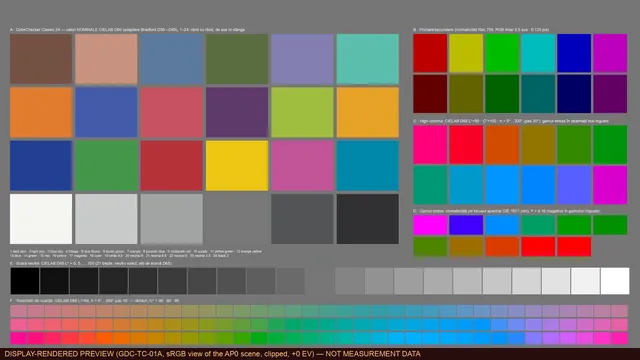

# GDC Test Charts 4K

[English](README.md) · [Español](README.es.md) · [Pagina web](https://gordas.dev/gdc-test-charts-4k/)

**Chart-uri de test gratuite și deschise pentru fluxuri de culoare: 575 de imagini EXR float32 3840×2160, în 23 de configurații colorimetrice și 12 familii de teste.**

## Ce este

O bibliotecă de chart-uri de test definite matematic, pentru verificarea IDT, ODT, DRT, LUT-urilor, pluginurilor OFX și transformărilor DCTL în DaVinci Resolve (sau în orice flux scene-referred). Aceleași 25 de chart-uri sunt redate separat în 23 de configurații de gamut și curbă, ca să testezi un instrument în spațiul în care lucrează de fapt.

## Descărcare

Nu e nevoie de cont, plată sau aplicație. **Biblioteca completă înseamnă 4 fișiere ZIP** (trei părți cu configurații diferite, plus arhiva de documentație și metadate). Nu se oferă un singur ZIP „tot”: datele au aproximativ 3,05 GB, iar un asset GitHub e limitat la 2 GiB. Fiecare ZIP are propriul folder principal, deci arhivele nu se suprapun.

**Biblioteca completă (descarcă toate cele trei părți, plus docs-metadata)**

| Fișier | Mărime | SHA-256 |
|---|---:|---|
| [`gdc-test-charts-4k-1.0.0-complete-part1of3.zip`](https://github.com/gordasgdc/gdc-test-charts-4k/releases/download/v1.0.0/gdc-test-charts-4k-1.0.0-complete-part1of3.zip) | 1.06 GB | `5e738c6bdb6fac3d2d7df0b1945c2a80f68e495920d0675d9c3afa6872bfa1d1` |
| [`gdc-test-charts-4k-1.0.0-complete-part2of3.zip`](https://github.com/gordasgdc/gdc-test-charts-4k/releases/download/v1.0.0/gdc-test-charts-4k-1.0.0-complete-part2of3.zip) | 1.06 GB | `aa25aac29951695fa1195508cd69f6946dfbe3dae3b5dd38a7bdc1a0b9084fe1` |
| [`gdc-test-charts-4k-1.0.0-complete-part3of3.zip`](https://github.com/gordasgdc/gdc-test-charts-4k/releases/download/v1.0.0/gdc-test-charts-4k-1.0.0-complete-part3of3.zip) | 931 MB | `f8746434b2cca31315bcea331c29a40be9255dea176503a412ff3ab6a4c70075` |
| [`gdc-test-charts-4k-1.0.0-docs-metadata.zip`](https://github.com/gordasgdc/gdc-test-charts-4k/releases/download/v1.0.0/gdc-test-charts-4k-1.0.0-docs-metadata.zip) | 17 MB | `2d9990e847e515c6e7581a2364b7259b714c7984576554801894ce7d774eb032` |

Configurații individuale (opțional, aprox. 130 MB fiecare; repetă conținutul părților): [`aces2065_ap0_lin`](https://github.com/gordasgdc/gdc-test-charts-4k/releases/download/v1.0.0/gdc-test-charts-4k-1.0.0-config-aces2065_ap0_lin.zip), [`acescct_ap1`](https://github.com/gordasgdc/gdc-test-charts-4k/releases/download/v1.0.0/gdc-test-charts-4k-1.0.0-config-acescct_ap1.zip), [`acescg_ap1_lin`](https://github.com/gordasgdc/gdc-test-charts-4k/releases/download/v1.0.0/gdc-test-charts-4k-1.0.0-config-acescg_ap1_lin.zip), [`apple_log_rec2020`](https://github.com/gordasgdc/gdc-test-charts-4k/releases/download/v1.0.0/gdc-test-charts-4k-1.0.0-config-apple_log_rec2020.zip), [`arri_awg3_logc3_ei800`](https://github.com/gordasgdc/gdc-test-charts-4k/releases/download/v1.0.0/gdc-test-charts-4k-1.0.0-config-arri_awg3_logc3_ei800.zip), [`arri_awg4_logc4`](https://github.com/gordasgdc/gdc-test-charts-4k/releases/download/v1.0.0/gdc-test-charts-4k-1.0.0-config-arri_awg4_logc4.zip), [`bmd_widegamut_gen4_filmgen4`](https://github.com/gordasgdc/gdc-test-charts-4k/releases/download/v1.0.0/gdc-test-charts-4k-1.0.0-config-bmd_widegamut_gen4_filmgen4.zip), [`bmd_widegamut_gen5_filmgen5`](https://github.com/gordasgdc/gdc-test-charts-4k/releases/download/v1.0.0/gdc-test-charts-4k-1.0.0-config-bmd_widegamut_gen5_filmgen5.zip), [`canon_cinemagamut_clog1`](https://github.com/gordasgdc/gdc-test-charts-4k/releases/download/v1.0.0/gdc-test-charts-4k-1.0.0-config-canon_cinemagamut_clog1.zip), [`canon_cinemagamut_clog2`](https://github.com/gordasgdc/gdc-test-charts-4k/releases/download/v1.0.0/gdc-test-charts-4k-1.0.0-config-canon_cinemagamut_clog2.zip), [`canon_cinemagamut_clog3`](https://github.com/gordasgdc/gdc-test-charts-4k/releases/download/v1.0.0/gdc-test-charts-4k-1.0.0-config-canon_cinemagamut_clog3.zip), [`dji_dgamut_dlog`](https://github.com/gordasgdc/gdc-test-charts-4k/releases/download/v1.0.0/gdc-test-charts-4k-1.0.0-config-dji_dgamut_dlog.zip), [`dwg_davinci_intermediate`](https://github.com/gordasgdc/gdc-test-charts-4k/releases/download/v1.0.0/gdc-test-charts-4k-1.0.0-config-dwg_davinci_intermediate.zip), [`filmlight_egamut_tlog`](https://github.com/gordasgdc/gdc-test-charts-4k/releases/download/v1.0.0/gdc-test-charts-4k-1.0.0-config-filmlight_egamut_tlog.zip), [`fujifilm_fgamut_flog`](https://github.com/gordasgdc/gdc-test-charts-4k/releases/download/v1.0.0/gdc-test-charts-4k-1.0.0-config-fujifilm_fgamut_flog.zip), [`fujifilm_fgamut_flog2`](https://github.com/gordasgdc/gdc-test-charts-4k/releases/download/v1.0.0/gdc-test-charts-4k-1.0.0-config-fujifilm_fgamut_flog2.zip), [`fujifilm_fgamutc_flog2c`](https://github.com/gordasgdc/gdc-test-charts-4k/releases/download/v1.0.0/gdc-test-charts-4k-1.0.0-config-fujifilm_fgamutc_flog2c.zip), [`gopro_rec2020_gplog2`](https://github.com/gordasgdc/gdc-test-charts-4k/releases/download/v1.0.0/gdc-test-charts-4k-1.0.0-config-gopro_rec2020_gplog2.zip), [`nikon_ngamut_nlog`](https://github.com/gordasgdc/gdc-test-charts-4k/releases/download/v1.0.0/gdc-test-charts-4k-1.0.0-config-nikon_ngamut_nlog.zip), [`panasonic_vgamut_vlog`](https://github.com/gordasgdc/gdc-test-charts-4k/releases/download/v1.0.0/gdc-test-charts-4k-1.0.0-config-panasonic_vgamut_vlog.zip), [`red_rwg_log3g10`](https://github.com/gordasgdc/gdc-test-charts-4k/releases/download/v1.0.0/gdc-test-charts-4k-1.0.0-config-red_rwg_log3g10.zip), [`sony_sgamut3_slog3`](https://github.com/gordasgdc/gdc-test-charts-4k/releases/download/v1.0.0/gdc-test-charts-4k-1.0.0-config-sony_sgamut3_slog3.zip), [`sony_sgamut3cine_slog3`](https://github.com/gordasgdc/gdc-test-charts-4k/releases/download/v1.0.0/gdc-test-charts-4k-1.0.0-config-sony_sgamut3cine_slog3.zip)

[SHA256SUMS.txt](https://github.com/gordasgdc/gdc-test-charts-4k/releases/download/v1.0.0/SHA256SUMS.txt) · [release v1.0.0](https://github.com/gordasgdc/gdc-test-charts-4k/releases/tag/v1.0.0)

## Ce conțin datele

Fiecare folder de configurație conține cele 25 de chart-uri (`GDC-TC-<ID>_<slug>__<configurație>__3840x2160.exr`) și un subfolder `MASTER/` cu fișierul lui de referință `GDC_STUDIO_MASTER_4K`. Arhiva `docs-metadata` conține manifestele per chart (ROI-uri, valori de referință, teste urmărite, limitări, proveniență, SHA-256), raportul de validare, `CATALOG.csv` și previzualizări sRGB.

## Familii

| ID | Familie | Ce testează |
|---|---|---|
| 01 | Colorimetrie | Verifici acuratețea unei transformări pe 24 de pătrate de referință, pe 21 de trepte neutre, pe primare, pe traiectorii de nuanță și pe puncte de stres de gamut. Variantele extinse adaugă felii LCh, limite de gamut și o scară ΔE. |
| 02 | Piele | 02A are valori construite pentru tonuri de piele: grilă ITA, iluminanți, expunere și traiectorii. 02B este un bust sintetic, o ILUSTRAȚIE pentru a testa măști spațiale, fără valori de referință. |
| 03 | Expunere | Trepte de 1 stop, 1/3 stop și Zone System, culoare în funcție de expunere, headroom și rampe continue în stopuri logaritmice sau liniare. Arată unde se comprimă sau se schimbă tonurile. |
| 04 | Saturație și nuanță | Baleiaje de saturație la luminanță constantă sau variabilă, roți de nuanță și chroma, rampe de nuanță, liniaritatea nuanței și interacțiunea nuanță × luminanță. Util pentru a depista deplasări de nuanță. |
| 05 | Balans de alb | Iluminanți × reflectanțe, deplasare tint (Duv), cinci metode de adaptare cromatică (CAT) și grile de eroare aproape de neutru, inclusiv piele versus neutru sub diferiți iluminanți. |
| 06 | Halation și bloom | Surse punctuale de mărimi și intensități diferite, emițători colorați, muchii, tranziții de contrast, linii neon și veiling glare, pentru a vedea cum se împrăștie lumina în efecte de film sau lentilă. |
| 07 | Focalizare și MTF | Muchii înclinate pentru metoda slanted-edge, stele Siemens, zone plates, chirp-uri, perechi de linii și muchii de contrast mic, pentru estimări de rezoluție și micro-contrast. |
| 08 | Grain și zgomot | 08A este referința CURATĂ, fără zgomot. 08B are variante CU zgomot gaussian controlat, cu seed fix, etichetate. Pornești de la curat și compari cu efectul unui instrument de grain sau de reducere a zgomotului. |
| 09 | Umbre | Trepte aproape de negru, valori sub negru și negative, scară de crush, rampe de lumină slabă, trecerea prin zero și croma în umbre. Arată unde se pierd sau se colorează umbrele. |
| 10 | Lumini și roll-off | Trepte și rampe în lumini, lumini saturate, supraîncărcarea unui canal, emițători și sonde de compresie a gamutului. Testează cum se comportă un look sau un DRT la capătul de sus. |
| 11 | Gradienți și banding | Rampe neutre foarte înguste și cuantizare simulată la 10, 8 și 6 biți, gradienți de nuanță, croma slabă, gradienți în zone aproape de negru sau alb și gradienți 2D. Dezvăluie banding-ul unui lanț de procesare. |
| 12 | Lentilă și optică (sintetic) | Grilă dreaptă pentru distorsiune, câmpuri plate, matrice de puncte și muchii tangențiale/sagitale pe 3×3 poziții de câmp. Sunt modele SINTETICE pentru instrumente de corecție, nu măsurători de obiectiv. |

## Configurații

| Folder = identificator de configurație | Gamut | Curbă |
|---|---|---|
| `aces2065_ap0_lin` | ACES2065-1 (AP0) | scene-linear |
| `acescct_ap1` | ACES AP1 | ACEScct |
| `acescg_ap1_lin` | ACES AP1 (ACEScg) | scene-linear |
| `apple_log_rec2020` | Rec.2020 (gamutul Apple Log) | Apple Log |
| `arri_awg3_logc3_ei800` | ARRI Wide Gamut 3 | ARRI LogC3 (EI 800) |
| `arri_awg4_logc4` | ARRI Wide Gamut 4 | ARRI LogC4 |
| `bmd_widegamut_gen4_filmgen4` | Blackmagic Wide Gamut Gen 4/5 | Blackmagic Film Gen 4 (Broadcast) |
| `bmd_widegamut_gen5_filmgen5` | Blackmagic Wide Gamut Gen 5 | Blackmagic Film Gen 5 |
| `canon_cinemagamut_clog1` | Canon Cinema Gamut | Canon Log |
| `canon_cinemagamut_clog2` | Canon Cinema Gamut | Canon Log 2 |
| `canon_cinemagamut_clog3` | Canon Cinema Gamut | Canon Log 3 |
| `dji_dgamut_dlog` | DJI D-Gamut | DJI D-Log |
| `dwg_davinci_intermediate` | DaVinci Wide Gamut | DaVinci Intermediate |
| `filmlight_egamut_tlog` | FilmLight E-Gamut | FilmLight T-Log |
| `fujifilm_fgamut_flog` | Fujifilm F-Gamut (primare Rec.2020) | Fujifilm F-Log |
| `fujifilm_fgamut_flog2` | Fujifilm F-Gamut (primare Rec.2020) | Fujifilm F-Log2 |
| `fujifilm_fgamutc_flog2c` | Fujifilm F-Gamut C | Fujifilm F-Log2 C |
| `gopro_rec2020_gplog2` | Rec.2020 (gamutul GP-Log2 conform GoPro) | GoPro GP-Log2 |
| `nikon_ngamut_nlog` | Rec.2020 (gamutul N-Log conform Nikon) | Nikon N-Log |
| `panasonic_vgamut_vlog` | Panasonic V-Gamut | Panasonic V-Log |
| `red_rwg_log3g10` | REDWideGamutRGB | RED Log3G10 |
| `sony_sgamut3_slog3` | Sony S-Gamut3 | Sony S-Log3 |
| `sony_sgamut3cine_slog3` | Sony S-Gamut3.Cine | Sony S-Log3 |

## Utilizare (DaVinci Resolve)

1. Alege configurația care corespunde spațiului în care lucrează instrumentul testat (de exemplu `dwg_davinci_intermediate` pentru un flux DaVinci Wide Gamut / Intermediate).
2. Extrage ZIP-ul și importă fișierele EXR din folderul configurației în Media Pool.
3. Declară exact spațiul de intrare: gamutul și curba din numele folderului, prin gestiunea culorii a proiectului (spațiul de intrare al clipului) sau printr-un nod Color Space Transform.
4. Evită transformarea dublă: dacă proiectul convertește deja intrarea, nu adăuga o a doua conversie pentru același spațiu. Fișierele EXR nu poartă o curbă de transfer pe care aplicația să o ghicească.
5. Măsoară pe pixeli reali, folosind ROI-urile (dreptunghiuri în pixeli) și valorile de referință din manifestul fiecărui chart (`docs-metadata`).
6. Citește limitele de mai jos înainte de a trage concluzii.

## Contractul datelor

OpenEXR, RGB, float32 (IEEE binary32), compresie ZIP fără pierderi, 3840×2160, scene-referred, full-range, fără tone mapping sau randare pentru afișaj, fără clipping. Valorile negative și cele peste 1 sunt intenționate (stres de gamut, headroom, sub-negru). Fiecare chart se compune o dată în ACES2065-1 (AP0, liniar) și se convertește AP0 → XYZ D65 (Bradford) → gamut țintă → curbă țintă. Aceleași valori de cod în două configurații **nu** sunt aceeași culoare. Fișierele EXR sunt identice octet cu octet cu originalele: fără conversie half-float, fără clipping, fără recomprimare.

### Previzualizările nu sunt date

`previews/` conține randări WebP pentru ecrane sRGB; pot fi clipate și servesc doar la navigare. Măsoară pe fișierele EXR, niciodată pe previzualizări sau capturi de ecran.



## Verifică descărcarea

Compară SHA-256 al fiecărui ZIP cu tabelul de mai sus sau cu `SHA256SUMS.txt` din release. În fiecare ZIP, `SHA256SUMS.txt` listează fiecare EXR.

```bash
shasum -a 256 gdc-test-charts-4k-1.0.0-complete-part1of3.zip      # macOS / Linux
```

```powershell
Get-FileHash -Algorithm SHA256 .\gdc-test-charts-4k-1.0.0-complete-part1of3.zip   # Windows
```

## Limite

- Chart-urile sunt sintetice: nu sunt capturi de cameră și nici chart-uri fizice măsurate. Valorile ColorChecker (CC24) sunt medii CIELAB nominale publicate, adaptate la D65 (loturile fizice diferă cu aprox. 1–2 ΔE).
- Nu reprezintă calibrare sau certificare pentru monitoare, obiective ori camere. 02B (bust sintetic) și familia 12 (lentilă și optică) sunt ilustrații/simulări.
- Versiunea generatorului: 1.0.0-proto. Raportul lui intern consemnează 32 364 de verificări automate, 0 eșecuri; la această publicare validarea **nu** a fost rerulată. Am verificat prezența fișierelor, dimensiunile și SHA-256 față de catalog, plus existența celor 23 de fișiere MASTER. Aprobarea vizuală a layoutului de către un om este încă în așteptare.
- 08B conține intenționat zgomot gaussian controlat (seed fix). Rândurile cuantizate din 11A sunt cuantizate în domeniul codului stocat, per configurație.
- Generatorul nu face parte din acest release.

## Licență și atribuire

Chart-uri, manifeste și documentație: [Creative Commons Attribution 4.0 International (CC BY 4.0)](https://creativecommons.org/licenses/by/4.0/) — utilizare, modificare și redistribuire, inclusiv comercială, cu atribuire. Scripturile ajutătoare din `scripts/` sunt publicate separat sub licența MIT (vezi `LICENSE-SCRIPTS`); CC BY nu se folosește pentru software. Numele de camere, formate și spații de culoare aparțin proprietarilor lor și apar doar ca identificatori tehnici; formulele provin din specificații publice.

Atribuire recomandată: `GDC Test Charts 4K © 2026 Dumitru Cristinel Gordas — https://gordas.dev/gdc-test-charts-4k/ — CC BY 4.0`

## Conținutul depozitului

`scripts/` inventar, împachetare, verificare, generare README/pagină · `previews/` previzualizări WebP optimizate · `docs/` tabel de descărcări și note de publicare · `LICENSE` textul juridic CC BY 4.0 · `LICENSE-SCRIPTS` MIT. Fișierele EXR există doar în GitHub Releases, niciodată în istoricul Git.

### Reproduce verificările

`python3 scripts/inventory.py --hash --out report.json` (reconcilierea sursei) · `python3 scripts/verify_archives.py --dir <folder cu ZIP-urile și packages.json> --catalog CATALOG.csv --extract <folder nou, gol>` (conținut, SHA-256, extragere).
